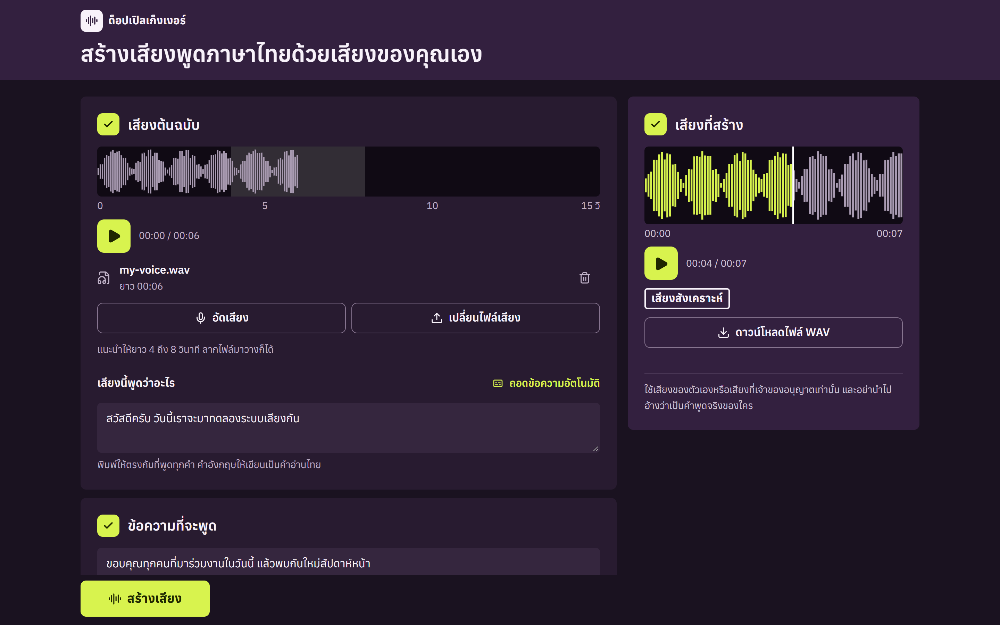

# ด็อปเปิลเก็งเงอร์ (Doppelgänger)

สร้างเสียงพูดภาษาไทยด้วยเสียงของคุณเอง จากเสียงตัวอย่างไม่กี่วินาที ไม่ต้องเทรนโมเดล และประมวลผลบนเครื่องของคุณ

*Local Thai text-to-speech that speaks in your own voice from a short sample. Windows only.*



> ใช้เสียงของตัวเองหรือเสียงที่เจ้าของอนุญาตเท่านั้น และห้ามนำเสียงที่สร้างไปอ้างว่าเป็นคำพูดจริงของใคร

## ทำอะไรได้บ้าง

- อัดเสียงจากไมโครโฟนหรือเลือกไฟล์ WAV MP3 M4A FLAC และ WebM
- ถอดข้อความจากเสียงด้วย faster-whisper แล้วแก้ไขเองได้
- สร้างเสียงภาษาไทยครั้งละไม่เกิน 500 ตัวอักษร ด้วย [F5-TTS-THAI](https://huggingface.co/VIZINTZOR/F5-TTS-THAI)
- ปรับโมเดลและความเร็ว ฟังผลในหน้าเว็บ แล้วดาวน์โหลดเป็นไฟล์ WAV

## สิ่งที่ต้องมี

- Windows 11 แบบ 64 บิต
- Python 3.10 ถึง 3.12 แบบ 64 บิต
- Node.js 20 ขึ้นไป
- FFmpeg และ FFprobe ที่เรียกจาก PATH ได้
- พื้นที่ว่างอย่างน้อย 20 GB
- แนะนำการ์ดจอ NVIDIA ที่มี VRAM 8 GB ขึ้นไป ใช้ CPU ได้แต่ช้ามาก

ทดสอบแล้วบน RTX 4070 Laptop 8 GB, RAM 16 GB และ Python 3.12

## ติดตั้ง

เปิด PowerShell แล้วรัน:

```powershell
git clone https://github.com/Martinnezsavemaiwai/Doppelg-nger.git
cd Doppelg-nger
.\setup.ps1
```

ถ้า PowerShell ไม่ยอมรันสคริปต์ ให้รันคำสั่งนี้ในหน้าต่างเดียวกันก่อน:

```powershell
Set-ExecutionPolicy -Scope Process -ExecutionPolicy Bypass
```

อยากตรวจเครื่องก่อนโดยยังไม่ติดตั้งอะไร ให้รัน `.\setup.ps1 -CheckOnly`

## เปิดโปรแกรม

```powershell
.\run.ps1
```

เบราว์เซอร์จะเปิดที่ `http://127.0.0.1:5173` การสร้างเสียงและการถอดข้อความครั้งแรกจะดาวน์โหลดโมเดล จึงอาจใช้เวลาหลายนาที

## วิธีใช้

1. **เสียงต้นฉบับ** อัดเสียงหรือเลือกไฟล์ที่ยาว 2 ถึง 15 วินาที แนะนำ 4 ถึง 8 วินาที แล้วกด **ถอดข้อความอัตโนมัติ** หรือพิมพ์เอง ข้อความต้องตรงกับที่พูดทุกคำ
2. **ข้อความที่จะพูด** พิมพ์สิ่งที่อยากให้พูด ใส่ลูกน้ำหรือจุดตรงที่อยากให้เว้นจังหวะ
3. กด **สร้างเสียง** ฟังผล แล้วดาวน์โหลดไฟล์ WAV ไฟล์ที่สร้างจะเก็บไว้ใน `outputs/generated/`

ดูวิธีอัดเสียงให้ได้ผลดีที่ [คู่มือเสียงต้นฉบับ](data/reference/README.md)

ถ้าเสียงพูดเร็วหรือรัวเกินไป ให้ลดความเร็วในเมนูตั้งค่าเสียง ค่าเริ่มต้นคือ 0.8 เท่าตามคำแนะนำของ F5-TTS-THAI

## ตั้งค่าเพิ่มเติม

กำหนดตัวแปรเหล่านี้ใน PowerShell ก่อนรัน `.\run.ps1`

| ตัวแปร | ค่าที่ใช้ได้ | ค่าเริ่มต้น |
| --- | --- | --- |
| `THAI_VOICE_DEVICE` | `auto` `cuda` `cpu` | `auto` |
| `THAI_VOICE_WHISPER_MODEL` | `tiny` `base` `small` `medium` หรือชื่อ checkpoint อื่น | `small` |
| `THAI_VOICE_WHISPER_DEVICE` | `cpu` `cuda` `auto` | `cpu` |

ตัวอย่างการบังคับใช้ CPU:

```powershell
$env:THAI_VOICE_DEVICE='cpu'
.\run.ps1
```

## ความเป็นส่วนตัว

- โปรแกรมรับการเชื่อมต่อจาก `127.0.0.1` เท่านั้น จึงไม่เปิดให้เครื่องอื่นเข้าถึง
- เสียงและข้อความของคุณไม่ถูกส่งออกนอกเครื่อง ไฟล์อัปโหลดชั่วคราวจะถูกลบเมื่อจบคำขอ
- ต้องใช้อินเทอร์เน็ตตอนติดตั้ง และตอนดาวน์โหลดโมเดลจาก Hugging Face ครั้งแรก
- ไฟล์ใน `data/reference/` และ `outputs/generated/` ถูกกันไม่ให้ขึ้น Git

## แก้ปัญหา

| อาการ | วิธีแก้ |
| --- | --- |
| ไม่พบ FFmpeg | ติดตั้ง FFmpeg เพิ่มลง PATH แล้วเปิด PowerShell ใหม่ |
| ใช้ CUDA ไม่ได้ | อัปเดต NVIDIA driver แล้วลองรัน `nvidia-smi` ไม่ต้องติดตั้ง CUDA Toolkit แยก |
| หน่วยความจำการ์ดจอไม่พอ | ปิดเกมหรือแอปที่ใช้ GPU แล้วลองใหม่ หรือใช้โหมด CPU |
| อัดเสียงไม่ได้ | อนุญาตไมโครโฟนให้ localhost ในเบราว์เซอร์ ตรวจว่าไม่มีแอปอื่นใช้อยู่ หรือเลือกไฟล์แทน |
| ถอดข้อความผิดหรือข้ามคำ | แก้ข้อความเอง ใช้เสียงที่สะอาดขึ้น หรือเลือกโมเดล Whisper ที่ใหญ่ขึ้น |
| ถอดข้อความช้า | ครั้งแรกต้องดาวน์โหลดโมเดลและค่าเริ่มต้นใช้ CPU เลือก `tiny` หรือ `base` จะเร็วขึ้น |
| backend ปิดระหว่างทำงาน | ดู `outputs/logs/backend.error.log` |

## ข้อจำกัด

- สคริปต์ติดตั้งและเปิดโปรแกรมรองรับเฉพาะ Windows
- ยังไม่มีการ fine-tune และการสร้างเสียงแบบ real-time
- ออกแบบมาให้ใช้บนเครื่องตัวเอง ไม่ควรเปิดให้เข้าผ่านเครือข่ายโดยไม่เพิ่มการยืนยันตัวตน

## พัฒนาต่อ

ดูโครงสร้างโปรเจกต์และวิธีรันเทสต์ที่ [CONTRIBUTING.md](CONTRIBUTING.md)

## สัญญาอนุญาตและเครดิต

โค้ดในโปรเจกต์นี้ใช้สัญญาอนุญาต [MIT](LICENSE)

โมเดลไม่ได้อยู่ใน repo นี้ โปรแกรมจะดาวน์โหลดมาเมื่อใช้งาน และแต่ละตัวมีเงื่อนไขของตัวเอง

| ส่วนประกอบ | สัญญาอนุญาตที่ระบุไว้ |
| --- | --- |
| [VIZINTZOR/F5-TTS-THAI](https://huggingface.co/VIZINTZOR/F5-TTS-THAI) (โมเดล V1) | `cc-by-4.0` |
| [VIZINTZOR/F5-TTS-TH-V2](https://huggingface.co/VIZINTZOR/F5-TTS-TH-V2) (โมเดล V2) | ไม่ได้ระบุ |
| [SWivid/F5-TTS](https://huggingface.co/SWivid/F5-TTS) (โมเดลต้นทางของ F5-TTS) | `cc-by-nc-4.0` |
| [faster-whisper](https://github.com/SYSTRAN/faster-whisper) (โค้ด) | MIT |

เงื่อนไขของโมเดลแต่ละตัวไม่ตรงกัน และโมเดลต้นทางห้ามใช้เชิงพาณิชย์ ถ้าจะนำเสียงที่สร้างไปใช้เชิงพาณิชย์ ให้ตรวจเงื่อนไขของโมเดลด้วยตัวเองก่อน
